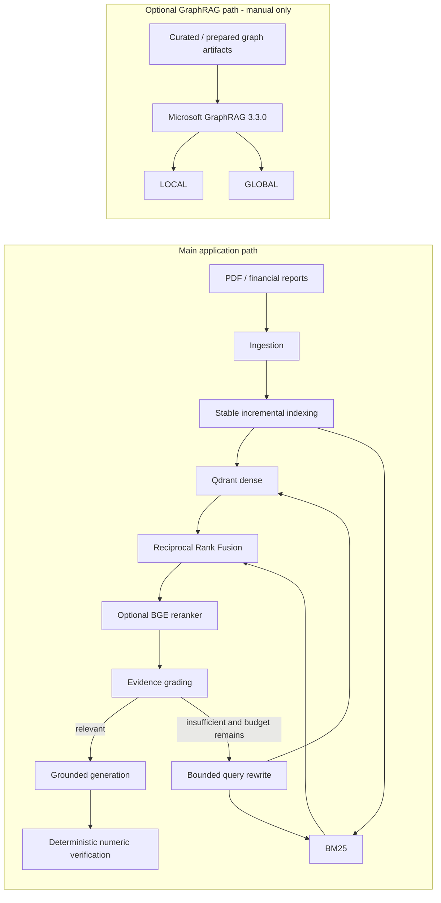

# FinRAG Analyst Agent

[](https://www.python.org/downloads/release/python-3120/)
[](https://github.com/doquoc188/Finance_Rag/actions/workflows/ci.yml)

FinRAG is a financial-report question-answering application built around traceable source
evidence. It combines incremental indexing, hybrid retrieval, bounded LangGraph correction,
grounded generation, and deterministic checks for explicit financial quantities.

The repository contains the API and Streamlit demo, reusable typed components under
`src/finrag`, deterministic offline tests, a versioned retrieval benchmark, and an isolated
Microsoft GraphRAG integration. The latest Phase 1.6 verification passed **408 tests**; the
only measured retrieval baseline is reported below.

**Run locally:** use the [Windows PowerShell quickstart](#windows-powershell-quickstart),
then start the API with `& $uv run --env-file .env uvicorn app.main:app --reload`. Verify the
offline baseline at any time with `& $uv run pytest`.

## Highlights

- Per-role model selection through an explicit multi-provider registry.
- Bounded LangGraph query rewriting and evidence-grounded answer generation.
- Deterministic `Decimal`-based numeric verification with three outcomes:
  `SUPPORTED`, `CONTRADICTED`, and `NOT_FOUND`.
- Qdrant dense retrieval and BM25 combined with Reciprocal Rank Fusion (RRF).
- Optional BGE cross-encoder reranking.
- Stable document/chunk IDs and manifest-based, non-destructive incremental indexing.
- A versioned retrieval evaluation harness with manually labeled queries.
- Optional Microsoft GraphRAG 3.3.0 LOCAL/GLOBAL adapter, isolated from the main runtime.
- Deterministic, network-free default test suite: **408 tests passed**.

## Architecture

The main application always uses its own retrieval path. GraphRAG is a separate manual,
opt-in path; there is no automatic router between them.



See [Architecture decisions](docs/architecture.md) for component boundaries and design
rationale.

## Implemented and deferred

| Implemented | Deliberately deferred |
| --- | --- |
| Explicit provider registry | Automatic GraphRAG routing |
| Role-based generation, grading, and rewrite models | Live LOCAL GraphRAG embedding preparation |
| Dense + BM25 hybrid retrieval with RRF | Production-scale GraphRAG indexing |
| Optional cross-encoder reranker | Document deletion API |
| Deterministic numeric verifier | Interrupted-index commit recovery |
| Bounded query correction | Concurrent-writer coordination |
| Retrieval evaluation harness | Generation quality benchmark |
| Stable incremental indexing | GraphRAG-vs-Hybrid benchmark |
| GraphRAG LOCAL/GLOBAL adapter |  |

## Measured evidence

### Retrieval benchmark

The recorded benchmark uses a curated synthetic finance fixture with **47 chunks**, **27
manually labeled queries**, and **6 companies**. Only the actual BM25 implementation was
measured in the recorded environment.

| Strategy | Recall@5 | Recall@10 | MRR@10 | Status |
| --- | ---: | ---: | ---: | --- |
| BM25 | 0.7593 | 0.8148 | 0.7025 | MEASURED |
| Dense | — | — | — | NOT MEASURED |
| Hybrid RRF | — | — | — | NOT MEASURED |
| Hybrid RRF + reranker | — | — | — | NOT MEASURED |

These results characterize one small fixture. They do not establish production quality or
superiority over the unmeasured strategies. See the [benchmark protocol](evals/retrieval/README.md),
[Markdown result](evals/retrieval/results/baseline.md), and
[machine-readable result](evals/retrieval/results/baseline.json).

### Microsoft GraphRAG live smoke

A deliberate GLOBAL smoke was executed successfully against Microsoft GraphRAG **3.3.0**
using the optional dependency. It validated a synthetic graph with 4 documents, 5 entities,
4 relationships, 4 text units, and 1 community report. The hosted query returned a response
and provenance containing all four curated document IDs. Cost was limited to one small,
deliberate hosted query.

This is integration/capability evidence, not a retrieval-quality measurement. The LOCAL
adapter is covered offline, but a real LOCAL query has not been executed because it requires
an `entity_description` LanceDB vector table prepared with the configured embedding model.
See the [GraphRAG demo notes](evals/graphrag/README.md).

### Test and quality gates

Latest local Phase 1.6 verification on 2026-10-10:

| Check | Result |
| --- | --- |
| `uv run pytest` | 408 passed, 2 existing Pydantic deprecation warnings |
| `ruff check src/finrag tests` | Passed |
| `ruff format --check src/finrag tests` | Passed |
| `mypy src/finrag` | Passed: 37 source files |

The broader legacy `app` tree is not hidden from the project record: repository-wide Ruff
still reports 8 findings, format check identifies 5 files, and `mypy app` reports 6 errors.
They are existing debt outside this documentation/CI phase.

## Windows PowerShell quickstart

Python 3.12 is required. The following setup uses the checkout-local `uv` bootstrap because
`uv` may not be on `PATH`:

```powershell
git clone https://github.com/doquoc188/Finance_Rag.git
Set-Location Finance_Rag

py -3.12 -m pip install --target .tools/bootstrap uv
$uv = ".\.tools\bootstrap\bin\uv.exe"
$env:UV_CACHE_DIR = Join-Path $PWD ".tools\uv-cache"
$env:UV_PYTHON_INSTALL_DIR = Join-Path $PWD ".tools\python"

Copy-Item .env.example .env
notepad .env  # Set OPENAI_API_KEY locally; optionally set GRAPHRAG_API_KEY.

& $uv sync --locked
& $uv run pytest
& $uv run --env-file .env uvicorn app.main:app --reload
```

The API is available at `http://localhost:8000` and its OpenAPI UI at
`http://localhost:8000/docs`. In a second PowerShell terminal, start the optional UI with:

```powershell
$uv = ".\.tools\bootstrap\bin\uv.exe"
& $uv run streamlit run ui/streamlit_app.py
```

Normal application setup does not install or initialize Microsoft GraphRAG.

## Environment variables

Copy `.env.example` to the ignored `.env` file and load it explicitly at the command
boundary. Never commit real values.

| Variable | Required | Purpose |
| --- | --- | --- |
| `OPENAI_API_KEY` | For the default chat provider | Credential read by the OpenAI adapter when it is constructed. |
| `GRAPHRAG_API_KEY` | Only for a deliberate live GraphRAG query | Dedicated credential referenced by `evals/graphrag/workspace/settings.yaml`. |
| `FINRAG_GENERATION__*` | Optional | Provider, model, and temperature for answer generation. |
| `FINRAG_GRADING__*` | Optional | Provider, model, and temperature for evidence grading. |
| `FINRAG_QUERY_REWRITE__*` | Optional | Provider, model, and temperature for bounded query rewriting. |
| `FINRAG_RETRIEVAL__*` | Optional | Retrieval limits, RRF constant, rewrite budget, and reranker configuration. |
| `FINRAG_EMBEDDING__*` | Optional | Embedding provider/model identity used for compatibility checks. |
| `FINRAG_INDEXING__MANIFEST_PATH` | Optional | Persistent index-manifest path; default is `.finrag/index-manifest.json`. |
| `QDRANT_LOCATION` | Optional | Legacy application Qdrant location; default `:memory:` is ephemeral. |
| `LANGCHAIN_TRACING_V2` | Optional | Enables LangSmith tracing when explicitly set to `true` with valid tracing configuration. |

Other provider credentials and extras are documented in
[Development foundation](docs/development.md).

## Demo commands

The snippets below assume `$uv` was set as shown in the quickstart.

### A. Run the offline test suite

```powershell
& $uv run pytest
```

### B. Run the API and Streamlit app

```powershell
& $uv run --env-file .env uvicorn app.main:app --reload
& $uv run streamlit run ui/streamlit_app.py  # Run in a second terminal.
```

### C. Reproduce the measured BM25 benchmark

```powershell
& $uv run python evals/retrieval/run_benchmark.py --strategies bm25
```

This command writes the result files under `evals/retrieval/results`. Dense and reranked
runs require explicitly available local model snapshots; the runner does not download or
silently replace them.

### D. Validate the GraphRAG fixture offline

```powershell
& $uv run python evals/graphrag/run_query.py --mode global --question "Summarize the synthetic cross-document dependency chain."
```

Expected output includes `REAL GRAPHRAG QUERY: NOT EXECUTED`. This command needs no
GraphRAG package, key, network access, or hosted model.

### E. Deliberately run the GLOBAL GraphRAG smoke

This opt-in command requires `GRAPHRAG_API_KEY`, requires `--live`, makes a hosted request,
and may incur API cost:

```powershell
& $uv run --extra graphrag --env-file .env python evals/graphrag/run_query.py --live --mode global --question "Summarize the synthetic cross-document dependency chain."
```

It is never run by pytest or CI.

## CI behavior

`.github/workflows/ci.yml` runs on Python 3.12 and uses the locked default dependency set.
It runs all offline tests, Ruff check/format gates for `src/finrag` and `tests`, and mypy for
`src/finrag`. It does not load `.env`, install the GraphRAG extra, require credentials, or
make paid API calls.

## Evidence suitable for a technical review

- Designed a typed, multi-provider chat registry with separate generation, grading, and
  query-rewrite model resolution.
- Built Qdrant dense + BM25 retrieval with rank-based RRF and optional cross-encoder
  reranking.
- Implemented deterministic explicit-quantity verification for financial answers.
- Added a bounded LangGraph correction loop and grounded model inputs.
- Reworked indexing around stable identities and non-destructive manifest-based updates.
- Built a reproducible retrieval evaluation with manually curated gold labels.
- Integrated Microsoft GraphRAG 3.3.0 behind an optional LOCAL/GLOBAL adapter and validated
  GLOBAL dispatch with one deliberate live smoke.
- Maintained 408 deterministic offline tests at the Phase 1.6 checkpoint.

## Limitations and safe evidence capture

- GraphRAG is not part of the normal chat runtime and has no automatic routing policy.
- Dense, Hybrid RRF, reranked retrieval, generation quality, and GraphRAG-vs-Hybrid quality
  have not been measured in the recorded benchmark.
- The numeric verifier checks explicit supported notation and lexical context. It is not a
  general factuality proof and does not perform FX or derived financial calculations.
- Index commits are retryable but are not transactional across Qdrant and the manifest;
  crash recovery and concurrent-writer coordination remain deferred.
- Default app execution can call the selected model provider. Only the test and offline
  fixture commands are guaranteed network-free.

If capturing demo screenshots, crop or redact API keys, private report content, personal
information, and local absolute paths. The successful GraphRAG terminal smoke is described
here, but no screenshot or raw hosted response is committed.

For the engineering contract and detailed current-state notes, see [AGENTS.md](AGENTS.md),
[Development foundation](docs/development.md), and the historical phase reports in `docs/`.
